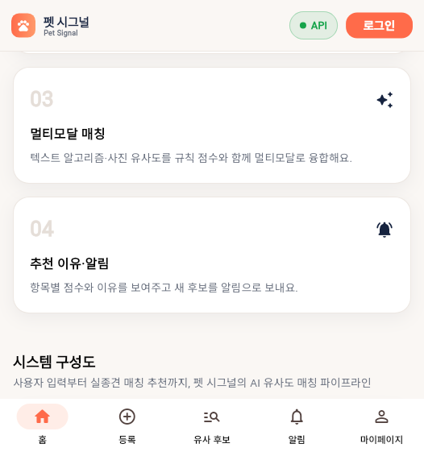
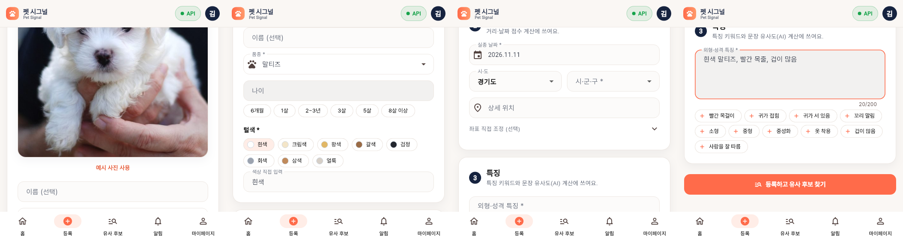
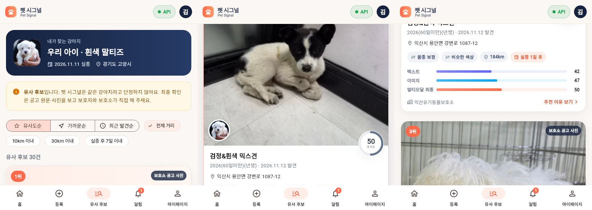
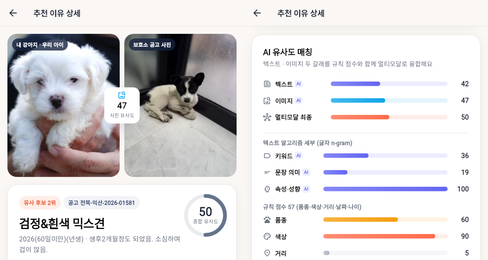

# 펫 시그널 (Pet Signal) — 10조 학회 시연 스타터

실종견과 공공 구조동물 공고를 **유사 후보**로 매칭하고, 품종·색상·거리·날짜·특징·나이·**사진·텍스트(AI)** 항목별 추천 이유를 보여주는 서비스입니다.

> 결과는 동일 개체로 단정하지 않습니다. 공고 원문(animal.go.kr)과 사진을 보호자·보호소가 직접 확인합니다.

## 📊 성능평가 (Top-5)

실제 보호소 공고 6,253건에서 가상 실종 신고 180건의 정답 공고를 찾게 한 결과, 상위 5개 안에 정답이 든 비율이
**기존 조건 검색 7.2% → 펫 시그널 85.6%** (Top-1 3.3% → 71.1%) 였습니다. 합성 시험 문제라는 한계와 자세한 표·그래프는
[`backend/eval/README.md`](backend/eval/README.md) 에 있고, `cd backend && python -m eval.run_eval` 한 줄로 다시 돌릴 수 있습니다.


## 🌐 라이브 데모

- 웹: https://rlawogus0703.github.io/pet-signal/ (가까운 보호소 공고는 로그인 없이 볼 수 있고, 실종견 등록·매칭은 회원가입 또는 로그인이 필요해요)
- API 서버: https://pet-signal-api.onrender.com (무료 플랜이라 첫 접속 시 30초~1분 깨어나는 시간이 있어요)

| 홈 | 시스템 구성도 |
|---|---|
|  |  |

**실종견 등록 (사진 + 특징)**


**실제 보호소 공고 후보 목록**


**추천 이유 상세 (규칙 점수 100점, 항목별 근거)**


## 팀 역할 (10조)

| 역할 | 담당 | 범위 |
|------|------|------|
| 웹 클라이언트 | **재현** | Flutter Web (로그인·회원가입 / 등록 / 후보 목록 / 추천 이유 / 알림) |
| 모바일 앱 | **민재** | Flutter App — 동일 API 사용 |
| 백엔드 | TBD | FastAPI + DB + 수집기 + 매칭 엔진 |

공유 계약: [`API_SPEC.md`](./API_SPEC.md)

## 매칭 점수: 규칙 점수 100점 (민재 앱과 같은 기준)

앱(민재)과 웹(재현)이 같은 기준으로 후보 순위를 매깁니다. 일치 근거를 합산한 점수이며, **동일견일 확률이 아닙니다.**

| 항목 | 만점 | 받는 조건 | 근거 예 |
|---|---|---|---|
| 품종 | 30 | 정규화한 품종이 같음 | `일치 (포메라니안)` |
| 색상 | 25 | 공통 색상이 하나라도 있음 | `공통 색상: 흰색` |
| 지역 | 20 | 시·도 + 시·군·구 표기가 같음 (실종 위치 ↔ 공고 관할 orgNm) | `다름 (경기 오산시 / 경기 연천군)` |
| 특징 | 15 | 보호자 설명과 공고 특징에 공통 단어가 있음 | `공통 특징 단어 없음` |
| 날짜 | 10 | 실종일 당일 또는 이후에 구조 접수됨 | `실종일 이후 구조 접수 (2026-11-04)` |

- 항목마다 다 받거나(만점) 못 받거나(0점)입니다. 같은 점수면 최근에 접수된 공고가 먼저 옵니다.
- 지역은 시군구 표기를 비교해요. 실제 거리와 사진 유사도는 계산하지 않아요. 구조 접수일은 실제 발견일과 다를 수 있어요.
- 코드: `backend/app/services/rule_points.py` (서버), `web/lib/matching/rule_points.dart` (웹 Mock 모드).
- API: `score.points`(예: 65), `score.max_points`(100), `score.items[]`(key·label·points·max·reason). `final_score`·`score.total` = points / 100.
- 예전 멀티모달 점수(규칙·텍스트·사진 융합) 코드는 성능평가(`backend/eval`)용으로 남아 있지만 순위에는 쓰지 않습니다.

서버와 웹(Mock 모드) 점수는 같습니다. `backend/tests/test_multimodal.py` 와 `web/test/scorer_alignment_test.dart` 가
같은 기준값(`web/test/fixtures/scoring_cases.json`)으로 확인합니다. 기준을 바꾸면
`cd backend && python -m scripts.export_scoring_fixture` 로 다시 만드세요.

## 폴더 구조

```
pet-signal/
  API_SPEC.md          # 공유 REST 계약 (+ /auth/*)
  README.md
  render.yaml          # Render 무료 웹 서비스 (backend)
  tools/deploy_pages.sh  # Flutter web 을 gh-pages 브랜치에 올리는 스크립트
  web/                 # Flutter Web (재현) — 기본 Mock, 배포 빌드는 API 모드
  backend/             # FastAPI + SQLite/PostgreSQL(Neon)
```

---

## Windows에서 웹 실행 (재현님) — Mock 기본

Flutter SDK: `C:\dev\flutter` · 프로젝트를 `C:\dev\pet-signal` 에 복사했다고 가정.

```bat
set PATH=C:\dev\flutter\bin;%PATH%
cd C:\dev\pet-signal\web
flutter pub get
flutter run -d chrome
```

VS Code: `C:\dev\pet-signal\web` 열고 디바이스 Chrome 선택 후 Run.

### 학회 시연 순서 (추천)

1. **홈**: 짧은 소개와 **실종견 등록하기**·**근처 공고 둘러보기** 버튼, 3단계 이용 순서. 가까운 공고는 로그인 없이 볼 수 있어요. 통계·정규화 예시·시스템 구성도는 **서비스 소개**에서 볼 수 있어요.
2. **회원가입 또는 로그인** 후 **실종견 등록**(사진은 선택, 직접 입력) → **유사 후보** 화면.
   - 서비스 소개의 정규화 예시처럼, 보호자는 “흰색 말티즈”, 보호소는 “크림색 믹스견”으로 올려도 후보에 오를 수 있어요.
3. 후보 카드 클릭 → **추천 이유 상세**: 내 사진 ↔ 공고 사진 나란히, **규칙 점수 NN/100** 과 품종·색상·지역·특징·날짜 항목 카드(점수·막대·한 줄 근거), 보호소 주소·연락처·공고 기간.
   - **서비스 소개** 화면의 **시스템 구성도**: 사용자 입력 → 실종견 DB + 공공데이터 API → 일치 비교 → 규칙 점수 100점 → 매칭 추천.
4. **알림** 탭: 신규 후보 알림(안 읽음 표시, 모두 읽음), **마이페이지**: 내 실종견 목록·로그아웃.

### 바로가기 URL

| 주소 뒤에 붙이기 | 화면 |
|---|---|
| `?tab=1` | 가까운 공고 (로그인 불필요. `tab`: 0 홈 · 1 가까운 공고 · 2 등록 · 3 후보 · 4 알림 · 5 마이페이지) |
| `?about=1` | 서비스 소개 (로그인 불필요. 통계·정규화 예시·시스템 구성도) |

- 미리 만들어진 데모 계정은 없습니다. 이메일로 가입하거나 로그인해 주세요. 회원가입/로그인 화면은 한 화면에서 탭으로 전환됩니다.
- 가까운 보호소 공고는 로그인 없이 볼 수 있고, 실종견 등록·매칭은 로그인이 필요합니다.
- 상단 **Mock 시연 모드** 버튼 → API 서버 모드로 전환 (서버 주소 입력). 모드를 바꾸면 로그인이 초기화됩니다.

### 오프라인(인터넷 없는 발표장) 대비

- 글꼴(Pretendard), 강아지 사진 17장, CanvasKit을 전부 앱에 포함했습니다.
- 빌드: `flutter build web --release --no-web-resources-cdn` → `build\web` 폴더를 아무 정적 서버로 실행
  (예: `cd build\web` 후 `python -m http.server 8080` → http://localhost:8080/ ).

### 웹 구조 (lib/)

```
main.dart                 앱 시작 + 선택적 URL 탭(?tab=1)
theme/app_theme.dart      디자인 시스템 (코랄 #FF6B4A + 네이비 #16233F, Pretendard)
state/app_state.dart      전역 상태: Mock/API 모드, 로그인, 내 실종견, 알림 수
state/example_dog.dart    스코어러 테스트용 논문 예시 실종견
screens/shell.dart        반응형 레이아웃 (넓은 화면: 사이드 메뉴 / 모바일: 하단 탭)
screens/home_screen.dart  사용자용 홈 (소개·등록/공고 버튼·3단계 이용 순서)
screens/about_screen.dart 서비스 소개 (통계·정규화 예시·시스템 구성도·기술 구성)
screens/auth_screen.dart  로그인 / 회원가입
screens/register_screen.dart   3단계 등록 폼 + 사진 업로드 + 미리보기
screens/candidates_screen.dart 후보 카드 그리드 + 정렬/필터 + 스켈레톤
screens/detail_screen.dart     항목별 점수·추천 이유·비교·보호소 연락
screens/notifications_screen.dart, my_page_screen.dart
matching/scorer.dart, normalizer.dart, explain.dart   웹 내장 매칭 엔진 + 추천 이유 문장
data/mock_data.dart       예시 공고 16건 (tools/gen_notices.py 로 생성, 서버 시드와 동일)
```

예시 공고를 고치려면 `tools/gen_notices.py` 를 수정하고 `python tools/gen_notices.py` 를 실행하세요
(`web/lib/data/mock_data.dart` 와 `backend/data/seed_notices.json` 이 같이 바뀝니다).
사진 출처: `web/assets/PHOTO_CREDITS.md` (Wikimedia Commons, CC 라이선스).

---

## Windows에서 백엔드 실행 (재현님 노트북, Python 3.10)

### 1) 설치 (처음 한 번)

```bat
cd C:\dev\pet-signal\backend
python -m venv .venv
.venv\Scripts\activate
python -m pip install -r requirements.txt
```

(선택) 진짜 AI 모델(CLIP 사진 임베딩 + 다국어 문장 임베딩)을 쓰려면 아래도 설치하세요. 약 2GB, 첫 실행 때 모델을 내려받습니다.
설치하지 않아도 경량 방식(색상 히스토그램 + dHash, 글자 n-gram)으로 시연이 됩니다.

```bat
python -m pip install -r requirements-ai.txt
```

### 2) 공공데이터 인증키 넣기 (`backend\.env`)

```bat
copy .env.example .env
notepad .env
```

`SERVICE_KEY=` 뒤에 공공데이터포털 마이페이지 → 활용신청 현황 → **일반 인증키(Decoding)** 를 붙여넣고 저장합니다.
(Encoding 키를 넣어도 자동 변환됩니다. `.env` 는 GitHub 에 올라가지 않아요.)

### 3) 키 확인 + 첫 수집

```bat
python -m scripts.collect_once --rows 20
```

`"ok": true`, `fetched`, `images.embedded` 숫자가 나오면 성공입니다.

### 4) 서버 실행

```bat
python -m uvicorn app.main:app --host 127.0.0.1 --port 8000
```

- 키가 있으면 시작할 때 **전국 보호 중인 강아지 공고 전체**를 백그라운드로 수집하고, 이후 60분마다 다시 수집합니다.
  - 공고중(`state=notice`) 공고는 전부 (2026년 11월 기준 약 1,300건)
  - 공고 기간이 끝났지만 아직 보호소에 있는(`state=protect`) 공고는 최근 90일치 (약 5,000건)
  - 합계 약 6,200건. 1000건씩 페이지로 받아 바로 저장해서 무료 서버(메모리 512MB)에서도 돌아갑니다.
  - 다음 수집 목록에서 빠진 공고(입양·반환 등)는 `목록제외`로 바꿔 매칭·둘러보기에서 빼고, 30일 뒤 정리합니다.
  - 사진 임베딩은 한 번에 다 하지 않고 수집할 때마다 최신 공고부터 최대 3,000장씩 이어서 계산합니다.
- 실제 공고가 들어오면 매칭은 실제 공고로만 하고, 키가 없으면 예시 공고 16건(샘플 데이터 모드)으로 동작합니다.
- 상태 확인: http://127.0.0.1:8000/api/v1/system (모드, 공고 수, 사진 임베딩 수, 텍스트/이미지 방식, 가중치)
- API 문서: http://127.0.0.1:8000/docs
- 바로 수집: http://127.0.0.1:8000/docs 에서 `POST /api/v1/admin/collect` (요청 헤더 `X-Admin-Key` 가 `.env` 의 `ADMIN_API_KEY` 와 같아야 합니다. 키가 없으면 관리자 주소는 막힙니다.)
- 수집량 조절은 `.env` 의 `COLLECT_STATES`(기본 `notice,protect`), `COLLECT_PROTECT_DAYS`(기본 90), `EMBED_BATCH_PER_RUN`(기본 3000), `COLLECT_INTERVAL_MINUTES`
- 수집 현황(보호 중 공고 수, 사진 임베딩 수)은 `GET /api/v1/system` 의 `collection` 에서 볼 수 있습니다.

### 5) 웹 연결

```bat
set PATH=C:\dev\flutter\bin;%PATH%
cd C:\dev\pet-signal\web
flutter pub get
flutter run -d chrome
```

앱 상단 **Mock 시연 모드** 버튼 → **API** 로 바꾸고 주소 `http://127.0.0.1:8000` → 로그인 → 사진과 함께 실종견 등록.
후보 카드와 상세 화면에 실제 보호소 사진(서버 경유 `/api/v1/notices/{id}/photo`), 규칙 점수(100점)와 항목별 근거, 보호소 주소·전화·공고 기간이 나옵니다.

### 테스트

```bat
cd C:\dev\pet-signal\backend
.venv\Scripts\activate
python -m pytest -q
```

### 새 공공 API 추가하기

`backend/app/sources/` 에 `NoticeSource` 를 상속한 클래스를 만들고 `registry.py` 의 `available_sources()` 에 넣으면
수집기가 같이 돌립니다 (공통 형태: `sources/base.py` 의 `NoticeRecord`).

---

## 배포 (GitHub Pages + Render + Neon)

노트북이 꺼져 있어도 누구나 쓸 수 있게, 웹은 GitHub Pages, API 서버는 Render 무료 플랜, DB 는 Neon PostgreSQL 에 올립니다. 인증키와 DB 주소는 GitHub 에 올리지 마세요.

### 1) Neon DB

1. [Neon 콘솔](https://console.neon.tech)에서 프로젝트(`pet-signal`)를 만듭니다. 지역은 Singapore처럼 가까운 곳을 권장합니다.
2. **Connect** 에서 `postgresql://` 로 시작하는 연결 주소를 복사합니다 (비밀번호가 보이도록 한 다음).

### 2) GitHub 에 코드 올리기

이 저장소(`https://github.com/rlawogus0703/pet-signal`)의 `main` 브랜치에 푸시합니다. `backend/.env` 는 `.gitignore` 에 있어서 올라가지 않습니다.

### 3) Render 에 API 서버 올리기

1. [Render](https://render.com)에 GitHub 계정으로 로그인합니다.
2. **New → Blueprint** 로 이 저장소를 연결하거나, `render.yaml` 이 있는 저장소를 선택합니다.
3. 서비스 이름 `pet-signal-api`(무료 플랜). 빌드는 `backend` 폴더에서 `pip install -r requirements.txt` 만 합니다 (CLIP 등 AI 추가는 설치하지 않아 메모리를 낮춥니다).
4. 환경 변수에 다음을 **대시보드에서만** 넣습니다.
   - `SERVICE_KEY` — 공공데이터포털 Decoding 키
   - `DATABASE_URL` — Neon 연결 주소 (`postgresql://...` 그대로 넣어도 서버가 `postgresql+psycopg://` 로 변환합니다. `sslmode=require` 가능)
   - `ADMIN_API_KEY` — 관리자 주소(`POST /api/v1/admin/collect`, `/admin/seed`)용 비밀 키. 요청 헤더 `X-Admin-Key` 와 같아야 합니다. 비워 두면 관리자 주소는 거부됩니다. GitHub 에 올리지 마세요.
5. 배포가 끝나면 주소(예: `https://pet-signal-api.onrender.com`)가 생깁니다. `/healthz` 가 `{"ok": true}` 이면 성공입니다. `/api/v1/system` 에서 `"mode": "api"` 와 공고 수를 확인할 수 있습니다.
6. 서버는 60분마다 공고를 다시 수집합니다 (`COLLECT_INTERVAL_MINUTES`). Render 무료 플랜은 인스턴스가 하나라 수집이 겹치지 않게 잠금을 씁니다.

시작 명령: `uvicorn app.main:app --host 0.0.0.0 --port $PORT`

### 4) GitHub Pages 에 웹 올리기 (`gh-pages` 브랜치)

워크플로 파일 없이, 빌드된 웹을 `gh-pages` 브랜치에 올려 Pages 원본으로 씁니다.

1. Render 주소를 확인한 뒤, 저장소 루트에서 아래를 실행합니다 (Linux/macOS, 또는 Git Bash).

```bash
./tools/deploy_pages.sh https://pet-signal-api.onrender.com
```

스크립트는 `flutter build web --release --base-href /pet-signal/ --no-web-resources-cdn --dart-define=API_BASE_URL=<렌더주소>` 로 빌드하고, `.nojekyll` 을 넣은 뒤 `gh-pages` 브랜치(orphan)에 올립니다.

2. 저장소 **Settings → Pages → Build and deployment → Source** 를 **Deploy from a branch** 로 두고, 브랜치는 `gh-pages` / 폴더는 `/` (root) 입니다.
3. 주소: `https://rlawogus0703.github.io/pet-signal/`  (빌드 때 API 주소가 들어 있으면 앱이 API 모드로 시작합니다.)

Windows에서 직접 빌드만 하려면:

```bat
set PATH=C:\dev\flutter\bin;%PATH%
cd C:\dev\pet-signal\web
flutter build web --release --base-href /pet-signal/ --no-web-resources-cdn --dart-define=API_BASE_URL=https://pet-signal-api.onrender.com
```

서버 CORS 는 GitHub Pages(`https://rlawogus0703.github.io`)와 localhost(임의 포트)를 기본으로 허용합니다.

### 5) 서버가 잠들지 않게 하기 (선택)

Render 무료 플랜은 잠시 접속이 없으면 잠들 수 있습니다. 발표 전에 `/healthz` 를 한 번 열어 두면 깨어납니다.

---

## 인증 API 요약

- `POST /auth/signup` — 회원가입 (이메일, 비밀번호, 이름, 전화 선택)
- `POST /auth/login` — 로그인 → JWT
- `GET /auth/me` — Bearer 토큰으로 내 정보
- `POST /api/v1/lost-dogs` — Bearer 있으면 `user_id` 연결

상세 JSON은 `API_SPEC.md` 참고.

## 다음 단계

1. ~~공공 API 키 발급 후 `SERVICE_KEY`로 실공고 수집~~ (완료)
2. Render + Neon + GitHub Pages 배포 (위 절차)
3. 민재 앱과 API_SPEC 동기화 (`age`, `image`/`text`, auth)
4. FCM 푸시는 시연용 알림 화면으로 대체 가능 → 이후 연동
