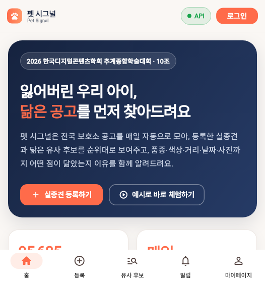

# 펫 시그널 (Pet Signal)

실종견과 공공 구조동물 공고를 유사 후보로 매칭하고, 추천 이유를 보여주는 서비스입니다.

결과는 같은 개라고 단정하지 않습니다. 공고 원문과 사진은 보호자·보호소가 직접 확인해야 합니다.

## 주소

- 웹: https://rlawogus0703.github.io/pet-signal/
- API 서버: https://pet-signal-api.onrender.com

가까운 보호소 공고는 로그인 없이 볼 수 있고, 실종견 등록과 매칭은 회원가입 또는 로그인이 필요합니다.
서버는 무료 플랜이라 처음 접속할 때 켜지는 데 조금 걸릴 수 있습니다.

## 사용한 기술

Flutter(웹), FastAPI, PostgreSQL, 공공데이터포털 구조동물 API

품종·색상·지역·특징·날짜를 점수(100점)로 비교해서 후보 순위를 보여줍니다. 배점은 품종 30, 색상 25, 지역 20, 특징 15, 날짜 10입니다.

## 주요 화면

- 홈: 소개와 실종견 등록하기, 근처 공고 둘러보기
- 실종견 등록 후 유사 후보 목록
- 추천 이유 상세: 항목별 점수와 보호소 연락처
- 알림, 마이페이지




## 폴더 구조

```
web/         Flutter 웹
backend/     FastAPI 서버
API_SPEC.md  API 설명
tools/       배포 스크립트
```

## 실행 방법

웹:

```bat
cd web
flutter pub get
flutter run -d chrome
```

서버:

```bat
cd backend
python -m venv .venv
.venv\Scripts\activate
python -m pip install -r requirements.txt
```

`.env` 파일을 만들고(`copy .env.example .env`) `SERVICE_KEY`에 공공데이터포털 인증키를 넣습니다.

```bat
python -m uvicorn app.main:app --host 127.0.0.1 --port 8000
```

API 형식은 `API_SPEC.md`를 보면 됩니다.

## 배포

웹은 GitHub Pages, API 서버는 Render, DB는 Neon PostgreSQL에 올립니다.
웹은 `./tools/deploy_pages.sh`로 `gh-pages` 브랜치에 올리면 됩니다.
서버는 `render.yaml`로 Render에 연결합니다.
인증키와 DB 주소는 GitHub에 올리지 마세요.
