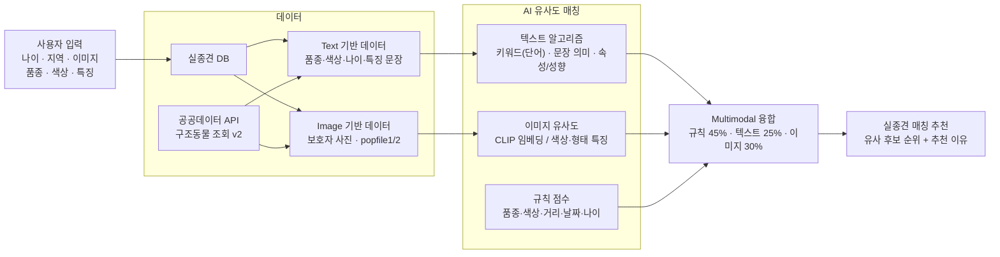

# 펫 시그널 (Pet Signal) — 10조 학회 시연 스타터

실종견과 공공 구조동물 공고를 **유사 후보**로 매칭하고, 품종·색상·거리·날짜·특징·나이·**사진·텍스트(AI)** 항목별 추천 이유를 보여주는 서비스입니다.

> 결과는 동일 개체로 단정하지 않습니다. 공고 원문(animal.go.kr)과 사진을 보호자·보호소가 직접 확인합니다.

## 팀 역할 (10조)

| 역할 | 담당 | 범위 |
|------|------|------|
| 웹 클라이언트 | **재현** | Flutter Web (로그인·회원가입 / 등록 / 후보 목록 / 추천 이유 / 알림) |
| 모바일 앱 | **민재** | Flutter App — 동일 API 사용 |
| 백엔드 | TBD | FastAPI + DB + 수집기 + 매칭 엔진 |

공유 계약: [`API_SPEC.md`](./API_SPEC.md)

## 시스템 구성도 (교수님 피드백 반영)



| 갈래 | 계산 | 코드 |
|---|---|---|
| 텍스트 (`text_score`) | 키워드 40% (특징 단어 Dice, 동의어·접두 일치) + 문장 의미 40% (sentence-transformers 다국어 임베딩, 없으면 글자 2-gram) + 속성·성향 20% (크기·목걸이·옷·귀·꼬리·털·온순/경계 추출 비교) | `backend/app/ai/text_similarity.py`, `web/lib/matching/text_similarity.dart` |
| 이미지 (`image_score`) | 보호자 사진 ↔ 공고 사진(popfile1). CLIP(ViT-B-32) 코사인, 모델이 없으면 색상 히스토그램 + dHash (Pillow만 필요) | `backend/app/ai/image_embedder.py`, `web/lib/matching/image_features.dart` |
| 규칙 (`rule_score`) | 품종 25 · 색상 25 · 거리 25 · 날짜 15 · 나이 10 (품종·색상 표기 정규화, 시군구 좌표 거리) | `backend/app/services/matcher.py`, `web/lib/matching/scorer.dart` |
| 최종 (`final_score`) | 규칙 45% + 텍스트 25% + 이미지 30%. 보호자 사진이 없으면 이미지 제외 후 재분배, 공고 사진만 없으면 이미지에 중립값 0.40 | `backend/app/ai/fusion.py` |

서버와 웹(Mock 모드) 점수 공식은 같습니다. `backend/tests/test_multimodal.py` 와 `web/test/scorer_alignment_test.dart` 가
같은 기준값(`web/test/fixtures/scoring_cases.json`)으로 확인합니다. 기준을 바꾸면
`cd backend && python -m scripts.export_scoring_fixture` 로 다시 만드세요.

## 폴더 구조

```
pet-signal/
  API_SPEC.md          # 공유 REST 계약 (+ /auth/*)
  README.md
  web/                 # Flutter Web (재현) — 기본 Mock 모드
  backend/             # FastAPI + SQLite/PostgreSQL
```

---

## Windows에서 웹 실행 (재현님) — Mock 기본

Flutter SDK: `C:\dev\flutter` · 프로젝트를 `C:\dev\pet-signal` 에 복사했다고 가정.

```bat
set PATH=C:\dev\flutter\bin;%PATH%
cd C:\dev\pet-signal\web
flutter pub get
flutter run -d chrome
```

VS Code: `C:\dev\pet-signal\web` 열고 디바이스 Chrome 선택 후 Run.

### 학회 시연 순서 (추천)

1. **홈**: 히어로, 95,685마리 통계, 문제/해결, "흰색 말티즈 vs 크림색 믹스견" 정규화 예시, 4단계 동작 방식.
2. **「예시로 바로 체험하기」** 버튼 → 데모 로그인 + 논문 예시 실종견(콩이, 흰색 말티즈, 오산시 양산동) 등록 → **유사 후보** 화면.
   - 1위: 오산시 원동 **크림색 믹스견**(일반 검색이면 빠지는 후보), 2위: 화성시 봉담 흰색 말티즈.
3. 후보 카드 클릭 → **추천 이유 상세**: 내 사진 ↔ 공고 사진 나란히, 텍스트/이미지/멀티모달 최종 막대 + 텍스트 세부(키워드·문장 의미·속성) + 규칙 항목, 추천 이유, 보호소 주소·연락처·공고 기간.
   - 홈 화면 아래 **시스템 구성도**: 사용자 입력 → 실종견 DB + 공공데이터 API(Text/Image) → AI 유사도 매칭 → Multimodal → 매칭 추천.
4. **알림** 탭: 신규 후보 알림(안 읽음 표시, 모두 읽음), **마이페이지**: 내 실종견 목록·로그아웃.
5. 직접 등록을 보여줄 땐 **실종견 등록** → 「논문 예시로 채우기」 또는 사진 업로드 후 직접 입력.

### 바로가기 URL (시연용)

| 주소 뒤에 붙이기 | 화면 |
|---|---|
| `?demo=1` | 데모 로그인 + 예시 실종견 → 유사 후보 |
| `?demo=1&detail=1` | 1위 후보 상세 |
| `?demo=1&tab=3` | 알림 (`tab`: 0 홈 · 1 등록 · 2 후보 · 3 알림 · 4 마이페이지) |
| `?login=1&tab=1` | 데모 로그인 후 등록 화면 |

- 데모 계정: `demo@petsignal.kr` / `demo1234` (Mock 모드에 미리 생성, API 모드에서는 없으면 자동 가입)
- 회원가입/로그인 화면은 한 화면에서 탭으로 전환됩니다.
- 상단 **Mock 시연 모드** 버튼 → API 서버 모드로 전환 (서버 주소 입력). 모드를 바꾸면 로그인이 초기화됩니다.

### 오프라인(인터넷 없는 발표장) 대비

- 글꼴(Pretendard), 강아지 사진 17장, CanvasKit을 전부 앱에 포함했습니다.
- 빌드: `flutter build web --release --no-web-resources-cdn` → `build\web` 폴더를 아무 정적 서버로 실행
  (예: `cd build\web` 후 `python -m http.server 8080` → http://localhost:8080/?demo=1 ).

### 웹 구조 (lib/)

```
main.dart                 앱 시작 + URL 바로가기(?demo=1 등)
theme/app_theme.dart      디자인 시스템 (코랄 #FF6B4A + 네이비 #16233F, Pretendard)
state/app_state.dart      전역 상태: Mock/API 모드, 로그인, 내 실종견, 알림 수
state/demo.dart           논문 예시 실종견 + 원클릭 시연
screens/shell.dart        반응형 레이아웃 (넓은 화면: 사이드 메뉴 / 모바일: 하단 탭)
screens/home_screen.dart  랜딩 (히어로·통계·동작 방식·기술 구성)
screens/auth_screen.dart  로그인 / 회원가입
screens/register_screen.dart   3단계 등록 폼 + 사진 업로드 + 미리보기
screens/candidates_screen.dart 후보 카드 그리드 + 정렬/필터 + 스켈레톤
screens/detail_screen.dart     항목별 점수·추천 이유·비교·보호소 연락
screens/notifications_screen.dart, my_page_screen.dart
matching/scorer.dart, normalizer.dart, explain.dart   웹 내장 매칭 엔진 + 추천 이유 문장
data/mock_data.dart       예시 공고 16건 (tools/gen_notices.py 로 생성, 서버 시드와 동일)
```

예시 공고를 고치려면 `tools/gen_notices.py` 를 수정하고 `python tools/gen_notices.py` 를 실행하세요
(`web/lib/data/mock_data.dart` 와 `backend/data/seed_notices.json` 이 같이 바뀝니다).
사진 출처: `web/assets/PHOTO_CREDITS.md` (Wikimedia Commons, CC 라이선스).

---

## Windows에서 백엔드 실행 (재현님 노트북, Python 3.10)

### 1) 설치 (처음 한 번)

```bat
cd C:\dev\pet-signal\backend
python -m venv .venv
.venv\Scripts\activate
python -m pip install -r requirements.txt
```

(선택) 진짜 AI 모델(CLIP 사진 임베딩 + 다국어 문장 임베딩)을 쓰려면 아래도 설치하세요. 약 2GB, 첫 실행 때 모델을 내려받습니다.
설치하지 않아도 경량 방식(색상 히스토그램 + dHash, 글자 n-gram)으로 시연이 됩니다.

```bat
python -m pip install -r requirements-ai.txt
```

### 2) 공공데이터 인증키 넣기 (`backend\.env`)

```bat
copy .env.example .env
notepad .env
```

`SERVICE_KEY=` 뒤에 공공데이터포털 마이페이지 → 활용신청 현황 → **일반 인증키(Decoding)** 를 붙여넣고 저장합니다.
(Encoding 키를 넣어도 자동 변환됩니다. `.env` 는 GitHub 에 올라가지 않아요.)

### 3) 키 확인 + 첫 수집

```bat
python -m scripts.collect_once --rows 20
```

`"ok": true`, `fetched`, `images.embedded` 숫자가 나오면 성공입니다.

### 4) 서버 실행

```bat
python -m uvicorn app.main:app --host 127.0.0.1 --port 8000
```

- 키가 있으면 시작할 때 공고(기본 2페이지 × 100건)를 백그라운드로 수집하고 사진 임베딩까지 계산, 이후 60분마다 다시 수집합니다.
- 실제 공고가 들어오면 매칭은 실제 공고로만 하고, 키가 없으면 예시 공고 16건(샘플 데이터 모드)으로 동작합니다.
- 상태 확인: http://127.0.0.1:8000/api/v1/system (모드, 공고 수, 사진 임베딩 수, 텍스트/이미지 방식, 가중치)
- API 문서: http://127.0.0.1:8000/docs
- 더 많이 수집: http://127.0.0.1:8000/docs 에서 `POST /api/v1/admin/collect` (pages, rows 지정)
- 수집량 조절은 `.env` 의 `COLLECT_PAGES`, `COLLECT_ROWS`, `COLLECT_INTERVAL_MINUTES`

### 5) 웹 연결

```bat
set PATH=C:\dev\flutter\bin;%PATH%
cd C:\dev\pet-signal\web
flutter pub get
flutter run -d chrome
```

앱 상단 **Mock 시연 모드** 버튼 → **API** 로 바꾸고 주소 `http://127.0.0.1:8000` → 로그인 → 사진과 함께 실종견 등록.
후보 카드와 상세 화면에 실제 보호소 사진(서버 경유 `/api/v1/notices/{id}/photo`), 텍스트/이미지/멀티모달 점수, 보호소 주소·전화·공고 기간이 나옵니다.

### 테스트

```bat
cd C:\dev\pet-signal\backend
.venv\Scripts\activate
python -m pytest -q
```

### 새 공공 API 추가하기

`backend/app/sources/` 에 `NoticeSource` 를 상속한 클래스를 만들고 `registry.py` 의 `available_sources()` 에 넣으면
수집기가 같이 돌립니다 (공통 형태: `sources/base.py` 의 `NoticeRecord`).

---

## 인증 API 요약

- `POST /auth/signup` — 회원가입 (이메일, 비밀번호, 이름, 전화 선택)
- `POST /auth/login` — 로그인 → JWT
- `GET /auth/me` — Bearer 토큰으로 내 정보
- `POST /api/v1/lost-dogs` — Bearer 있으면 `user_id` 연결

상세 JSON은 `API_SPEC.md` 참고.

## 다음 단계

1. 백엔드 담당 확정 후 PostgreSQL·스케줄러 주기·가중치 튜닝
2. ~~공공 API 키 발급 후 `SERVICE_KEY`로 실공고 수집~~ (완료: `backend/.env`)
3. 민재 앱과 API_SPEC 동기화 (`age`, `image`/`text`, auth)
4. FCM 푸시는 시연용 알림 화면으로 대체 가능 → 이후 연동
