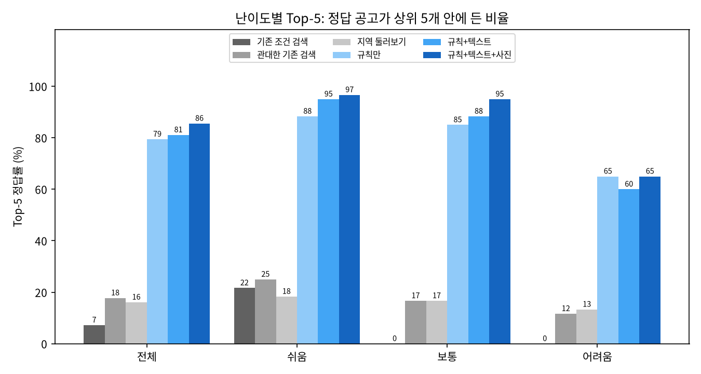
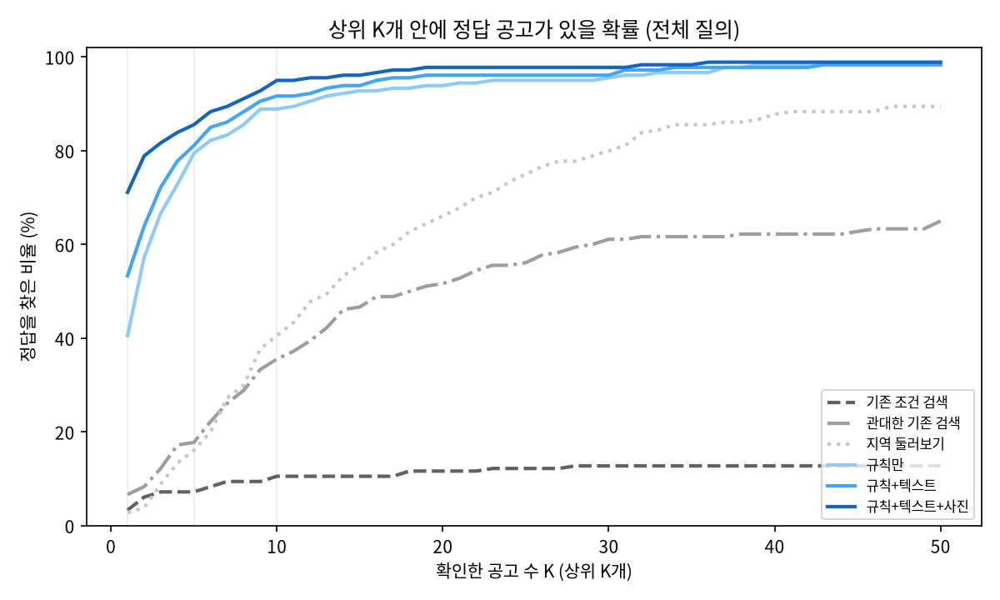

# 펫 시그널 성능평가 (Top-K)

**한 줄 요약:** 실제 보호소 공고 6,253건 속에서 '정답 공고'를 찾는 시험 180문제를 풀게 했더니,
기존 조건 검색은 상위 5개 안에 정답을 넣은 비율이 **7.2%**, 펫 시그널(규칙+텍스트+사진)은 **85.6%** 였습니다.

> 가상(합성) 시험 문제입니다. 실제 "실종 신고 ↔ 보호소 공고" 같은 개 쌍 데이터가 없어서,
> 실제 공고 하나를 정답으로 정하고 그 개를 잃어버린 보호자가 썼을 법한 신고서를 규칙으로 만들었습니다.
> 숫자는 이런 표기 차이·위치 차이가 있을 때 얼마나 버티는지를 보여 주는 값이고, 실제 서비스 정답률과 같다고 볼 수 없습니다.

## 실행

```bash
cd backend
pip install -r requirements.txt -r eval/requirements.txt   # matplotlib, numpy 는 평가 전용
python -m eval.run_eval                                     # 저장된 공고 스냅샷(eval/data/pool.json.gz)으로 평가
python -m eval.run_eval --refresh-pool                      # 공공 API 에서 공고를 새로 받아 평가 (DATA_GO_KR_SERVICE_KEY 필요)
```

- 처음 실행하면 후보 공고 사진 6천여 장을 받아 경량 사진 특징을 계산합니다 (약 50분, `eval/cache/` 에 저장돼 다음부터는 1분 이내).
- 운영 DB(Neon)·서버·계정은 건드리지 않습니다. 점수는 서비스 코드(`app.services.matcher.score_pair`, `app.ai.fusion`)를 그대로 불러 계산하고,
  평가 스크립트의 가중치 계산이 서비스 `total` 과 같은지 실행할 때마다 표본 검사합니다.
- 결과: `eval/results/` — `summary.csv`·`summary.json`(전체 수치), `per_query.csv`(문제별 정답 순위), `weight_sensitivity.csv`, 그래프 2장.

## 평가 데이터

| 항목 | 값 |
|---|---|
| 후보 공고 | 6,253건 (2026-11-15 02:42 KST 스냅샷, 서비스와 같은 조건: 공고중 1,308 + 보호중 최근 90일 4,945, 개만) |
| 공고 사진 특징 | 6,119건 성공 (134건은 사진 다운로드 실패 → 서비스처럼 중립값 0.40) |
| 시험 문제 | 180건 = 쉬움 60 · 보통 60 · 어려움 60 (고정 시드 20261115, 정답 공고 중 믹스견 159건) |
| 사진 있는 문제 | 140건 (사진 없음 36 + 사진 받기 실패 4) |
| 사진 방식 | 경량 `color-hist+dhash` (Render 와 같음). CLIP은 이 평가 환경에 torch가 없어 제외 |
| 텍스트 문장 의미 | 글자 2-gram (sentence-transformers 미설치, Render 와 같음) |

### 가상 실종 신고 만드는 법 (`eval/synth.py`)

실제 공고 하나를 뽑아 정답으로 두고, 보호자 입장에서 다음처럼 바꿔 씁니다.

| | 쉬움 | 보통 | 어려움 |
|---|---|---|---|
| 품종 | 70% 공고와 같은 글자, 30% 다른 표기(믹스견→믹스) | 다른 표기·'○○ 믹스'·보호자가 믿는 품종(믹스견→말티즈) | 30% 모름/시고르자브종, 보호자가 믿는 품종(백구·황구·진돗개…), 오타 |
| 색 | 50% 같은 글자, 50% 같은 색 다른 말(흰색→백색) | 60% 같은 색 다른 말, 40% 이웃 색(흰색→크림색) | 60% 이웃 색, 대표 색 하나만 |
| 실종 위치 | 발견 지점에서 0.5~1.5km | 1~3km | 2~5km |
| 실종 날짜 | 발견 1~2일 전 | 1~4일 전 | 3~7일 전 |
| 특징 글 | 70~100% 유지 | 30~60% + 말 바꿈(목줄→목걸이, 온순함→착해요) + 보호자 말투 | 0~30% + 보호자 말투 |
| 나이 | 공고 나이 그대로 (○살) | ±1살 | 50% 안 씀, ±2살 |
| 사진 | 원본 사진 약간 변형(자르기·밝기·JPEG) | 공고의 **다른 사진(popfile2)** 또는 중간 변형, 20% 사진 없음 | 다른 사진+강한 변형 또는 강한 변형, 40% 사진 없음 |

- 매처 사전(`normalizer.py`)에 있는 동의어만 쓰면 점수가 부풀려지므로, **사전에 없는 표기**(몰티즈, 포메리안, 백구, 황구, 흑구, 누렁이,
  시고르자브종, 살구색, 은색, 누런색 등)도 일부러 섞었습니다.
- 보호자가 고르는 시·군·구는 실종 지점이 속한 곳입니다 (옮긴 지점이 다른 시·군·구 중심에 더 가까우면 그쪽).
- 보호소 전용 문구(접종, 마을배회, 해당없음 등)는 보호자가 알 수 없으니 특징 글에서 뺐습니다.

### 비교한 방법

| 이름 | 설명 |
|---|---|
| 기존 조건 검색 | animal.go.kr 처럼 **품종 글자 일치 + 색 글자 포함 + 시·군·구 일치 + 실종일부터 30일**, 최신순. 품종 '모름'이면 품종 조건 없음 |
| 관대한 기존 검색 | 품종을 드롭다운처럼 **정규화**해서 비교(믹스=믹스견), 색 조건 없음, 시·군·구 + 30일, 최신순 |
| 지역 둘러보기 | 시·군·구 + 30일만 걸고 최신순으로 전부 넘겨보기 |
| 규칙만 | 펫 시그널 규칙 점수 (품종·색 정규화 0.25·0.25, 거리 0.25, 날짜 0.15, 나이 0.10) |
| 규칙+텍스트 | 규칙 0.45 + 텍스트 0.25 (사진 없을 때 서비스 동작과 같음) |
| 규칙+텍스트+사진 | 규칙 0.45 + 텍스트 0.25 + 사진 0.30 = **현재 서비스** |

순위는 6,253건 전체에서 매기고, 점수가 같으면 정답에 불리하게(같은 점수 공고를 모두 앞에 둠) 셉니다.

## 결과

### 전체 (180문제)

| 방법 | Top-1 | Top-5 | Top-10 | MRR | 아예 못 찾음 | 정답까지 본 공고 수(찾은 경우 평균) | 중앙값 순위 |
|---|---|---|---|---|---|---|---|
| 기존 조건 검색 | 3.3% | 7.2% | 10.6% | 0.057 | **86.7%** | 9.0 | - |
| 관대한 기존 검색 | 6.7% | 17.8% | 35.6% | 0.142 | 31.1% | 18.1 | 18.5 |
| 지역 둘러보기 | 2.8% | 16.1% | 40.6% | 0.126 | 1.1% | 21.3 | 14 |
| 펫 시그널: 규칙만 | 40.6% | 79.4% | 88.9% | 0.567 | 0% | 5.7 | 2 |
| 펫 시그널: 규칙+텍스트 | 53.3% | 81.1% | 91.7% | 0.653 | 0% | 4.8 | 1 |
| **펫 시그널: 규칙+텍스트+사진** | **71.1%** | **85.6%** | **95.0%** | **0.783** | 0% | **3.7** | **1** |

- 기존 검색 결과 목록 길이 평균: 조건 검색 1.6건, 관대한 검색 17.7건, 지역 둘러보기 29.5건.
- '아예 못 찾음' = 조건에 걸러져 정답이 목록에 없음. 펫 시그널은 전체 공고에 순위를 매기므로 0% 입니다.

### 난이도별 Top-5

| 방법 | 쉬움 | 보통 | 어려움 |
|---|---|---|---|
| 기존 조건 검색 | 21.7% | 0.0% | 0.0% |
| 관대한 기존 검색 | 25.0% | 16.7% | 11.7% |
| 지역 둘러보기 | 18.3% | 16.7% | 13.3% |
| 규칙만 | 88.3% | 85.0% | 65.0% |
| 규칙+텍스트 | 95.0% | 88.3% | 60.0% |
| 규칙+텍스트+사진 | 96.7% | 95.0% | 65.0% |

난이도별 Top-1 / MRR (규칙+텍스트+사진): 쉬움 96.7% / 0.971, 보통 81.7% / 0.877, 어려움 35.0% / 0.501.
쉬움에서도 기존 조건 검색이 60% 를 아예 못 찾는 이유는 색을 같은 뜻 다른 말(흰색→백색)로 쓰거나 '믹스견' 대신 '믹스'라고만 써도 글자가 안 맞기 때문입니다.





### 사진 종류별 (규칙+텍스트 → +사진, Top-1 / Top-5)

| 질의 사진 | 문제 수 | 규칙+텍스트 | 규칙+텍스트+사진 |
|---|---|---|---|
| 원본 약간 변형 | 59 | 74.6% / 96.6% | 98.3% / 98.3% |
| 원본 중간 변형 | 19 | 63.2% / 78.9% | 84.2% / 89.5% |
| 원본 강한 변형 | 10 | 40.0% / 50.0% | 50.0% / 70.0% |
| 공고의 다른 사진 (popfile2) | 31 | 64.5% / 90.3% | 83.9% / 96.8% |
| 다른 사진 + 강한 변형 | 21 | 14.3% / 61.9% | 47.6% / 66.7% |
| 사진 없음 (받기 실패 포함) | 40 | 32.5% / 70.0% | 32.5% / 70.0% |

'원본 약간 변형'은 공고 사진과 거의 같은 사진이라 사진 점수가 쉽게 맞습니다 (낙관적).
실제 보호자 사진에 가까운 건 '다른 사진' 쪽이지만, 같은 보호소에서 같은 날 찍어 배경·조명이 비슷하다는 점은 여전히 유리합니다.

### 가중치 민감도 (규칙 : 텍스트 : 사진, 180문제)

| 규칙 | 텍스트 | 사진 | Top-1 | Top-5 | Top-10 | MRR |
|---|---|---|---|---|---|---|
| **0.45** | **0.25** | **0.30** (현재) | 71.1% | 85.6% | 95.0% | 0.783 |
| 0.60 | 0.20 | 0.20 | 70.6% | 88.9% | 96.1% | 0.792 |
| 0.55 | 0.15 | 0.30 | 72.8% | 87.8% | 96.1% | 0.802 |
| 0.40 | 0.40 | 0.20 | 70.0% | 86.1% | 93.3% | 0.772 |
| 0.34 | 0.33 | 0.33 | 70.6% | 85.0% | 91.7% | 0.770 |
| 0.30 | 0.20 | 0.50 | 68.9% | 82.2% | 90.0% | 0.754 |
| 0.70 | 0.30 | 0 | 53.9% | 82.8% | 91.7% | 0.658 |
| 0.50 | 0.50 | 0 | 52.8% | 77.8% | 88.9% | 0.635 |

사진을 빼면 Top-1 이 17~18%p 떨어지고, 규칙 비중을 조금 올리면(0.55~0.60) 약간 좋아집니다.
다만 차이가 1~3문제 수준이고 가상 데이터라, 이 결과만으로 서비스 가중치를 바꾸지는 않았습니다.

## 해석

1. **표기 차이에 강합니다.** 기존 조건 검색은 글자가 정확히 같아야 해서 보통·어려움 문제에서 0% 였습니다. 펫 시그널은 품종·색 정규화와 이웃 색 점수 덕분에 같은 조건에서 Top-5 85~95% 를 유지했습니다.
2. **'조건을 느슨하게 거는 것'만으로는 부족합니다.** 품종을 정규화하고 색 조건을 뺀 관대한 검색도 Top-5 17.8%. 같은 동네·같은 기간에 공고가 평균 18~30건이라, 최신순 정렬로는 정답이 묻힙니다. 거리·날짜·특징·사진으로 **순서를 매기는 것**이 핵심입니다.
3. **사진이 Top-1 을 크게 끌어올립니다** (53.3% → 71.1%). 특히 다른 사진을 쓴 문제에서도 Top-1 64.5% → 83.9%.
4. **어려움 문제는 아직 약합니다** (Top-5 65%). 보호자가 믹스견을 '말티즈'·'백구'로 믿고 쓰거나, 색을 이웃 색으로 쓰고, 2~5km·3~7일 떨어진 경우입니다. 어려움에서는 텍스트를 더하면 Top-5 가 65% → 60% 로 오히려 떨어졌습니다 (보호자 말투 문장이 엉뚱한 공고와 글자가 겹침).

## 한계

- **합성 쌍입니다.** 변형 규칙을 우리가 정했기 때문에, 실제 보호자가 쓰는 말·사진과 다를 수 있습니다. 실제 정답 쌍(보호자에게 돌아간 사례)으로 다시 재야 합니다.
- **사진이 낙관적입니다.** 쉬움 문제는 공고 사진을 변형한 것이고, 다른 사진(popfile2)도 같은 보호소·같은 날 사진입니다. 집에서 찍은 보호자 사진은 훨씬 어렵습니다.
- **좌표가 시·군·구 중심점입니다.** 공고에 정확한 좌표가 없어 같은 시·군·구 공고는 거리가 모두 같습니다. 2026년에 새로 생긴 인천 서해구·검단구·제물포구, 전남광주통합특별시 등은 좌표 사전에 없어 시·도 중심점으로 잡힙니다.
- **기존 검색은 흉내입니다.** animal.go.kr 의 실제 검색 화면을 그대로 돌린 것이 아니라, 같은 조건을 코드로 걸었습니다 (실제 사이트에는 색 조건이 없고 품종은 목록에서 고릅니다 → '관대한 기존 검색'이 더 가깝습니다).
- 후보 공고는 한 시점 스냅샷이라, 실종일 이후에 올라올 공고까지 이미 들어 있습니다 (날짜 점수가 이를 반영하긴 합니다).
- 문제 수가 180개라 1문제 = 0.56%p 입니다. 방법 사이 몇 %p 차이는 우연일 수 있습니다.
- 사진은 경량 방식만 평가했습니다. CLIP(`requirements-ai.txt`)을 설치한 노트북에서 돌리면 다른 결과가 나올 수 있습니다.
